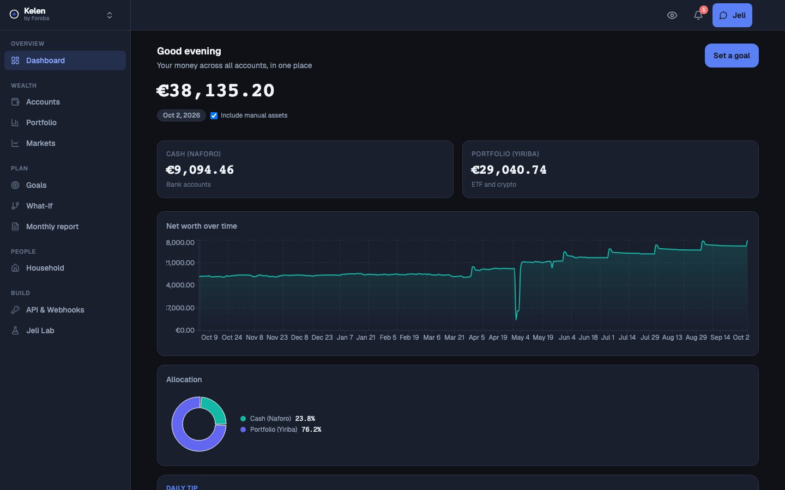
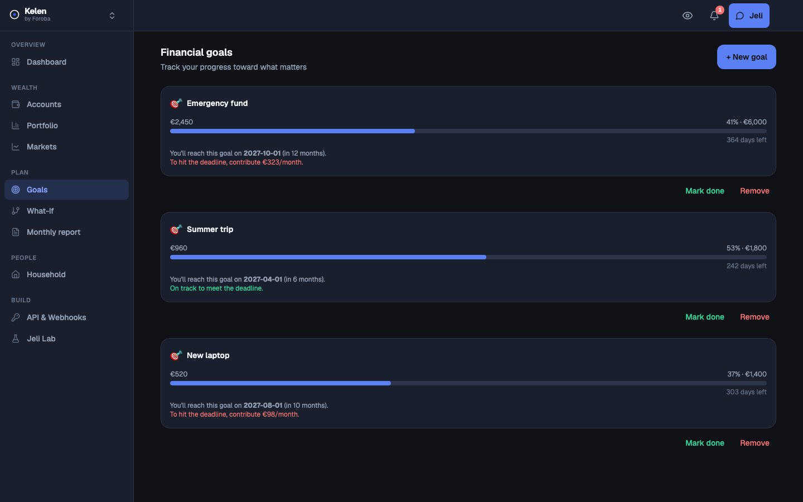
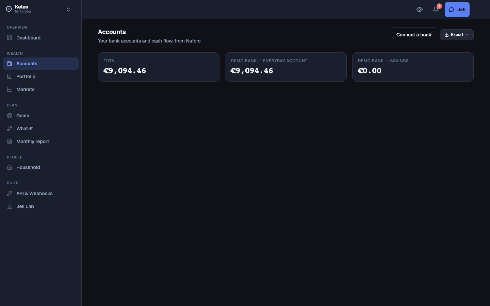
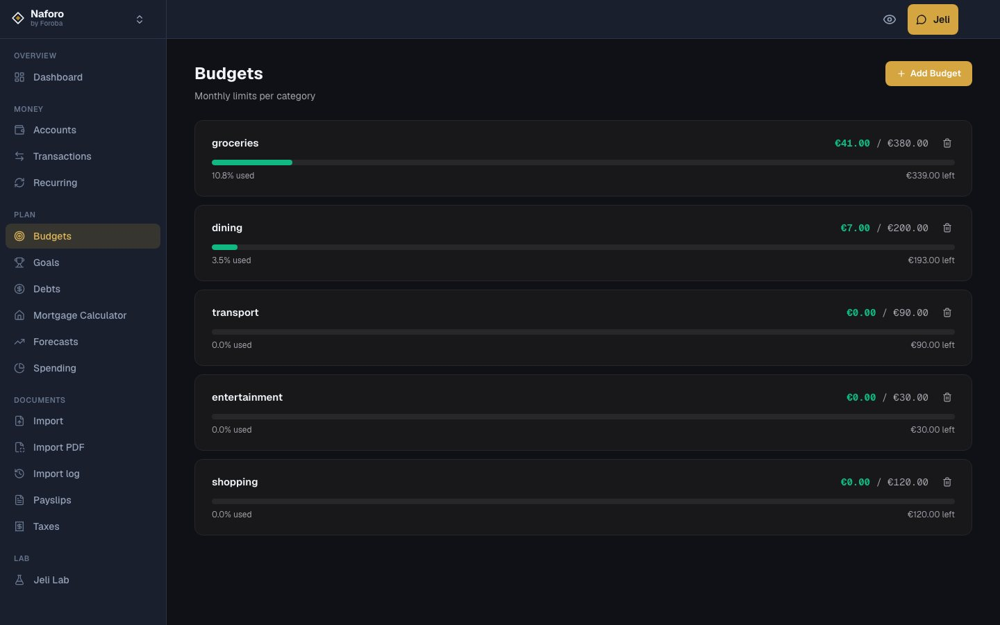
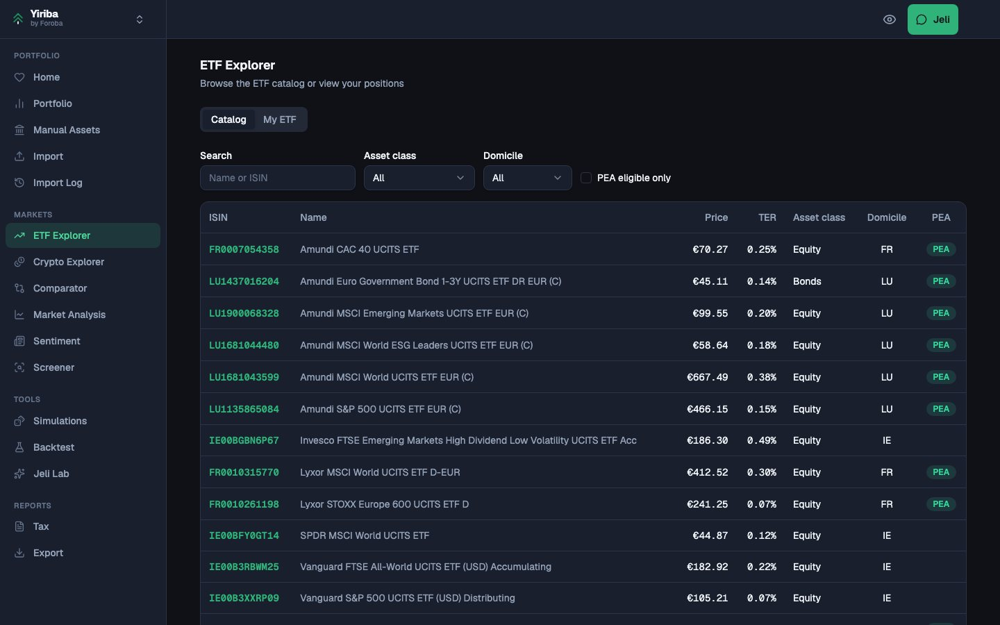
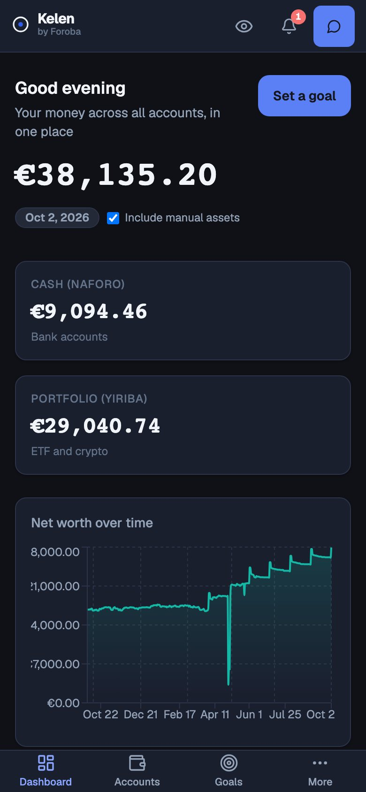
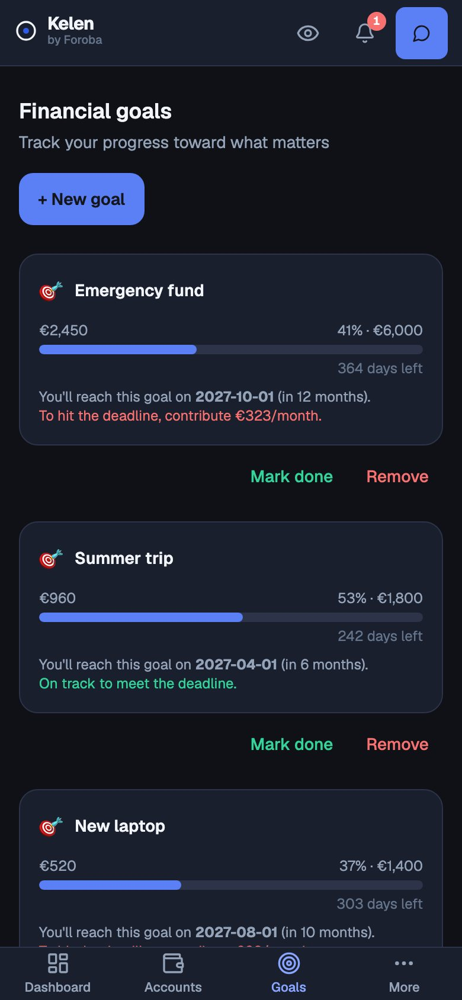
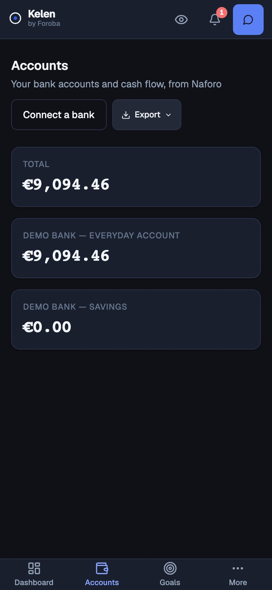

<div align="center">

# Kelen

**Your whole wealth, at a glance.**

A privacy-first personal-finance super-app: bank accounts, ETFs and crypto, goals and an AI assistant,
unified in one secure, local-first-minded workspace.

[forobalabs.com](https://forobalabs.com) · Built by **Foroba Labs**



</div>

---

## What is Kelen?

Kelen (Bambara for *"one"*) is the shell of a three-app personal-finance suite. It gives people **one place to see
everything they own**, without handing their data to an ad-driven aggregator:

| App | Role | Repo |
| --- | --- | --- |
| **Kelen** *(this repo)* | Identity, security, dashboard, goals, net worth, AI assistant, billing, admin | `ForobaLabs/kelen` |
| **Naforo** | Bank accounts, transactions, budgets | `ForobaLabs/naforo` |
| **Yiriba** | ETF and crypto portfolios, market data | `ForobaLabs/yiriba` |
| **Jeli** | AI assistant (gateway + sandboxed "Jeli Lab") living inside Kelen | this repo (`ai-gateway/`, `sandbox-runner/`) |
| **@foroba/ui** | Shared design system (tokens, components, themes) | `ForobaLabs/foroba-ui` |
| **Kelen for iOS** | Capacitor app wrapping the whole suite | `ForobaLabs/kelen-ios` |

Kelen is the **identity provider and front door**: it signs users in, mints the session that Naforo and Yiriba trust,
and stitches their data into one net-worth view.

## Highlights

- **One net worth.** Bank balances, ETF and crypto positions and liabilities are consolidated in the display currency
  of your choice (live ECB FX rates), with history and allocation breakdowns.
- **Goals and what-if.** Track savings goals, share a read-only goal link, and simulate scenarios
  (contribution changes, return assumptions) before committing to them.
- **Jeli, an AI assistant that respects your data.** Answers are grounded in your own figures, outputs are checked by
  a guard that blocks invented monetary values, and a PII-masking gateway sits in front of every cloud model call.
  You can bring your own key (BYOK) or stay on a local model.
- **Monthly report.** A generated PDF summary of the month, on demand.
- **Households.** Share selected data read-only with a partner or family member.
- **Developer-friendly.** Personal API keys and signed webhooks.
- **Dark-first, accessible, multilingual.** Dark and light themes, tabular figures everywhere money is shown,
  English / French / Italian out of the box.

<table>
  <tr>
    <td width="50%"></td>
    <td width="50%"></td>
  </tr>
  <tr>
    <td align="center"><sub>Goals with projections</sub></td>
    <td align="center"><sub>Accounts across every app</sub></td>
  </tr>
  <tr>
    <td width="50%"></td>
    <td width="50%"></td>
  </tr>
  <tr>
    <td align="center"><sub>Naforo: budgets</sub></td>
    <td align="center"><sub>Yiriba: ETF explorer</sub></td>
  </tr>
</table>

<p align="center">
  
  &nbsp;
  
  &nbsp;
  
</p>

<sub>All screenshots use seeded, fictional demo data.</sub>

## Security and privacy by design

Money apps earn trust through engineering, not slogans. What is implemented here:

| Area | Implementation |
| --- | --- |
| **Authentication** | Argon2id password hashing, passkeys (WebAuthn), TOTP, e-mail OTP, single-use recovery codes, per-user rate limits and attempt caps |
| **Session model** | Short-lived **RS256 JWTs** minted by Kelen and verified by Naforo/Yiriba through a **JWKS** endpoint; server-side revocation and session floors |
| **Step-up** | Sensitive actions require a fresh second factor (HTTP 428 challenge), scoped per app |
| **Web hardening** | Origin/CSRF checks on state-changing requests, strict CORS allow-lists, secure same-site cookies |
| **Data at rest** | SQLCipher-encrypted databases, encrypted backups with an off-site copy and retention job |
| **AI safety** | PII masking (NER) before any external model call, per-feature consent, daily quotas, output guard against fabricated figures, sandboxed code execution (no network, read-only FS, resource caps) |
| **Compliance** | GDPR export and erasure flows, versioned consent and re-consent |
| **Supply chain** | Pinned dependencies, OSV scanning, Dependabot, secret scanning in CI |

Found something? See [SECURITY.md](SECURITY.md).

## Architecture at a glance

```
                      ┌──────────────────────────────┐
   Browser / iOS ───► │  Kelen  (React SPA + FastAPI) │  identity · dashboard · goals · billing
                      └──────┬───────────┬───────────┘
              RS256 session  │           │  masked, consented requests
              (JWKS)         │           ▼
        ┌────────────────────┴──┐   ┌──────────────┐     ┌────────────────┐
        │ Naforo   │ Yiriba     │   │  AI gateway  │ ──► │ local / cloud  │
        │ (banks)  │ (ETF, crypto)│  │ (mask, BYOK) │     │ LLM providers  │
        └──────────┴────────────┘   └──────┬───────┘     └────────────────┘
                                           ▼
                                   Jeli Lab sandbox
```

A deeper walk-through lives in [docs/ARCHITECTURE.md](docs/ARCHITECTURE.md).

## Tech stack

- **Frontend:** React 19, TypeScript, Vite, Tailwind CSS v4, TanStack Query, React Router, Recharts, i18next, Vitest
- **Backend:** Python, FastAPI, Pydantic v2, SQLCipher (SQLite), Alembic, Argon2, PyJWT
- **AI:** OpenAI-compatible provider layer, spaCy-based PII masking, Ollama for local models
- **Billing:** Paddle (merchant of record) with signed-webhook verification
- **Delivery:** Docker, nginx, GitHub Actions (lint, type-check, tests, OSV and secret scanning)
- **Mobile:** Capacitor (Kelen for iOS)

## Quality

- 800+ backend tests (auth, IDOR matrix, billing, AI guards, migrations) and 50+ frontend test files
- Cross-user authorization (IDOR) matrix run across all three backends before every beta milestone
- Alembic migrations kept in lockstep with the runtime schema initialiser

## Getting started

Kelen is source-visible, not open-source (see [License](#license)). To explore the code locally:

```bash
# Backend (FastAPI, port 8002)
cd backend
python -m venv .venv && .venv/bin/pip install -r requirements.txt
.venv/bin/pytest -q                       # run the test-suite
AUTH_DEV_BYPASS=true .venv/bin/uvicorn main:app --port 8002

# Frontend (Vite, port 5175)
pnpm install && pnpm dev
```

The frontend consumes the private `@foroba/ui` design system (`file:../foroba-ui`), so running the UI requires
access to that repository. Configuration is documented in `backend/.env.example`.

## Roadmap

Private beta is under way: comp access for early testers, Enable Banking (PSD2) connectivity for Naforo, and a single
**Kelen** iOS app that bundles the whole suite.

## License

Copyright © 2026 Foroba Labs. All rights reserved. The source is published so that it can be read and evaluated;
it may not be copied, redistributed or used to operate a competing service. See [LICENSE](LICENSE).

---

<div align="center">
  <sub>Built with care by <a href="https://forobalabs.com">Foroba Labs</a>.</sub>
</div>
