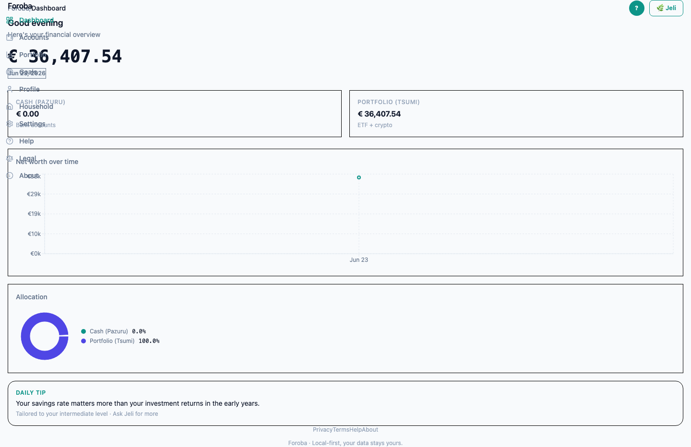
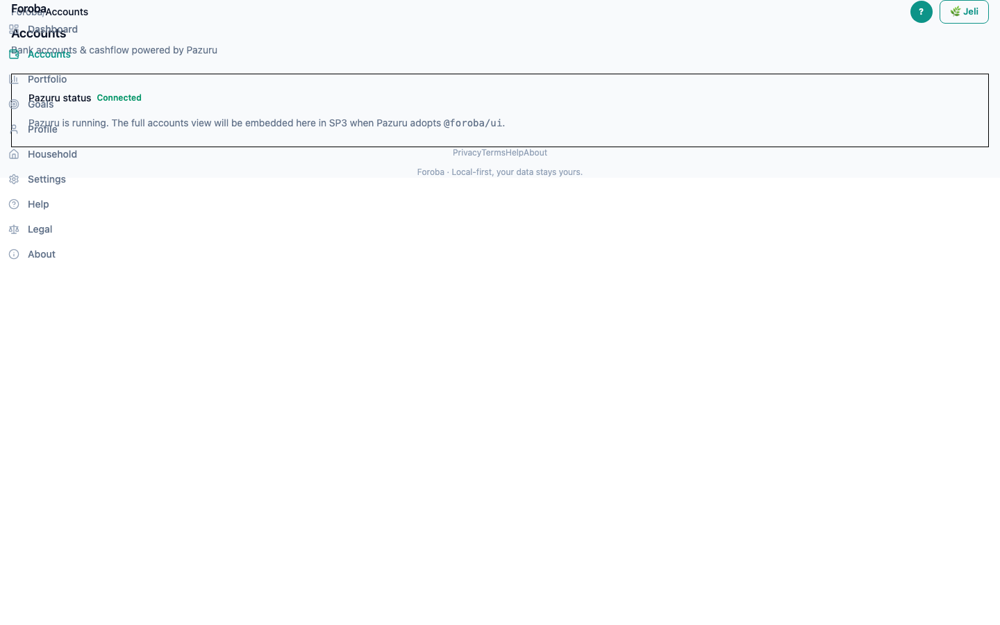
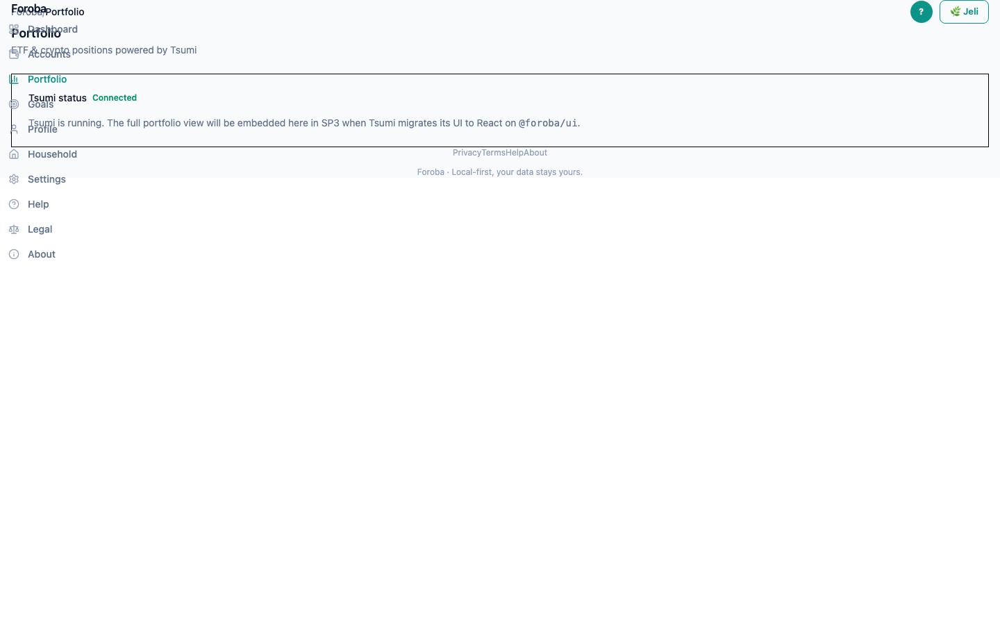
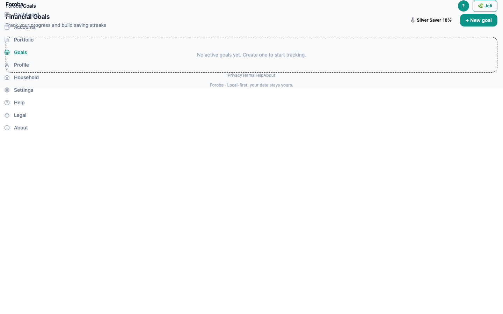
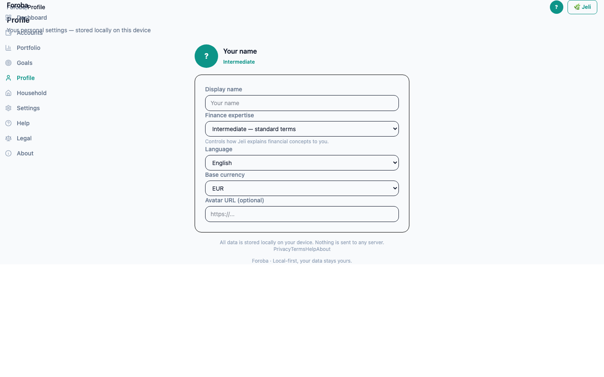
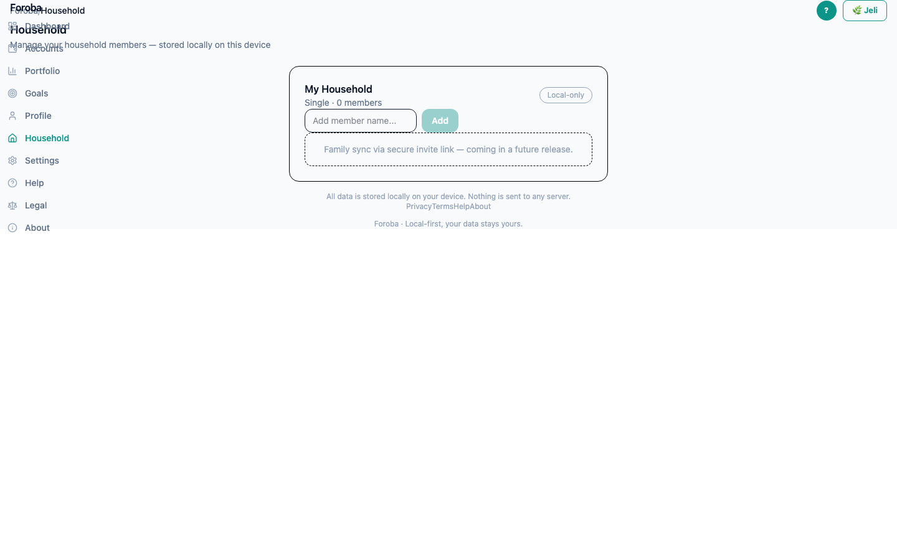
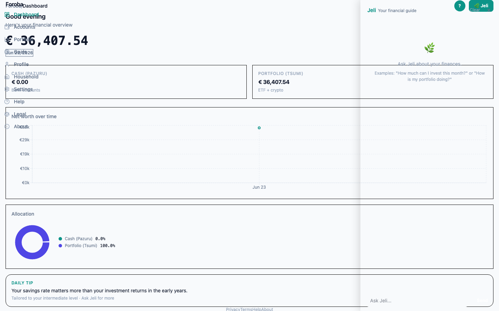
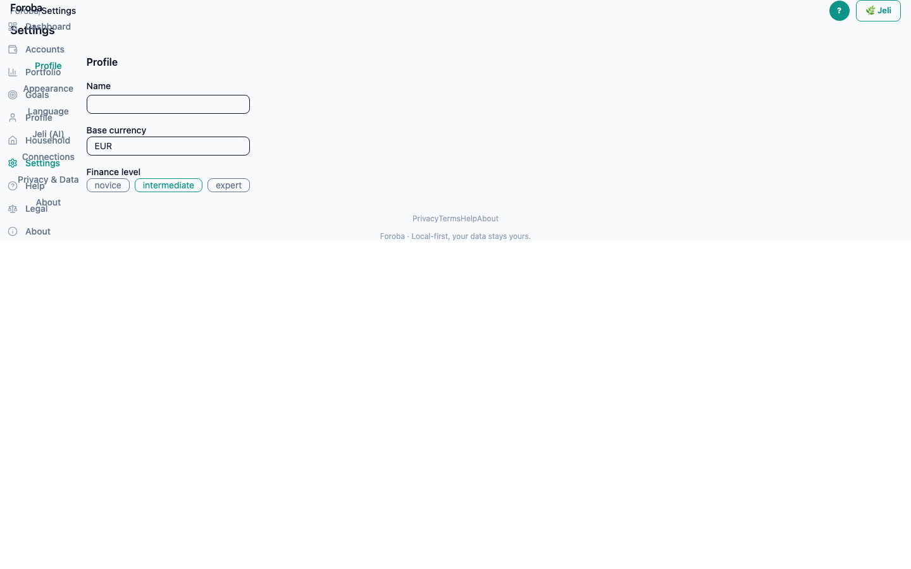

# Foroba — User Guide

**Foroba** (*fòroba* = "common field / common wealth") is the superapp shell that
unifies your two finance apps into one place: **Pazuru** (bank accounts) and
**Tsumi** (ETF & crypto portfolio). It aggregates their data into a single net-worth
view and embeds **Jeli**, your local AI assistant.

> Local-first: your data stays on your machine.

## Start the app

```bash
cd foroba
./dev.sh        # starts the Jeli backend (:8002) + the web UI (:5175)
```

For full aggregation, also start Pazuru (`pazuru/dev.sh`) and Tsumi (`tsumi/dev.sh`).
Open **http://localhost:5175**.

---

## Dashboard (`/`)



Your financial cockpit:
- **Net worth** — the big number at the top, aggregated across all apps.
- **Cash (Pazuru)** — total liquidity pulled from your bank accounts.
- **Portfolio (Tsumi)** — current ETF + crypto value.
- **Net worth over time** — historical trend line.
- **Allocation** — donut split between Cash and Portfolio.
- **Daily tip** — a contextual suggestion tailored to your finance level.

If a service is offline you'll see a banner; the dashboard still shows whatever data
is available.

## Accounts (`/accounts`)



Bank accounts aggregated from Pazuru, with balances and account types.

## Portfolio (`/portfolio`)



ETF and crypto positions aggregated from Tsumi, with total value and returns.

## Goals (`/goals`)



Track your savings goals and progress toward each target.

## Profile (`/profile`)



Your personal profile and finance experience level — this drives the tailored tips
and Jeli's tone.

## Household (`/household`)



Manage household members so finances can be viewed individually or together.

## Jeli — AI assistant



Click the **Jeli** button (top-right) to open the assistant panel. Jeli is
page-aware and runs locally — ask it about your net worth, spending, or goals.

## Settings · Help · Legal · About



- **Settings** — theme (light/dark), language, display preferences.
- **Help** (`/help`) — usage tips and FAQ.
- **Legal / Privacy / Terms** — local-first data policy and disclaimers.
- **About** — version and project info.
